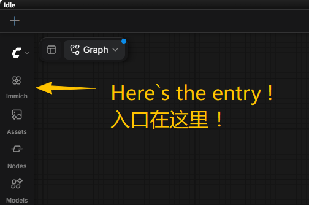
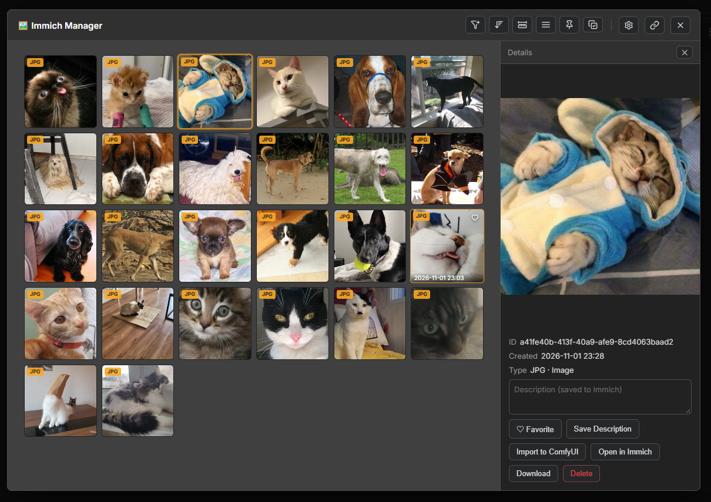
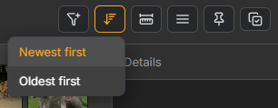
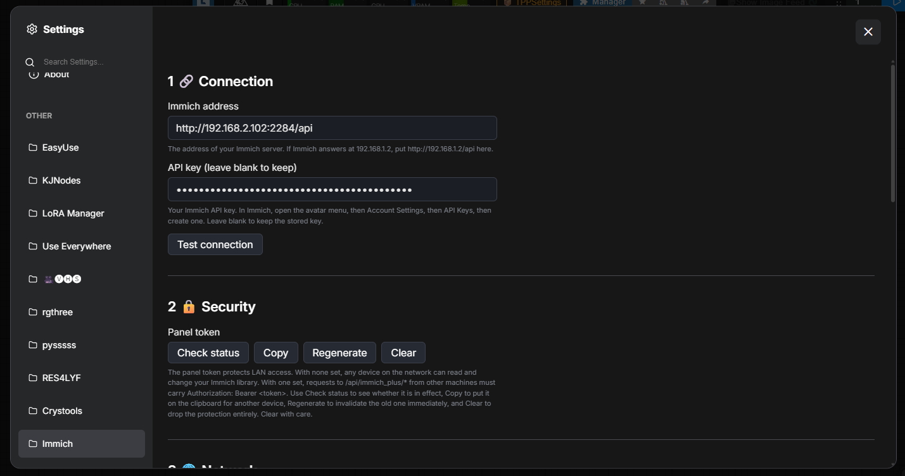
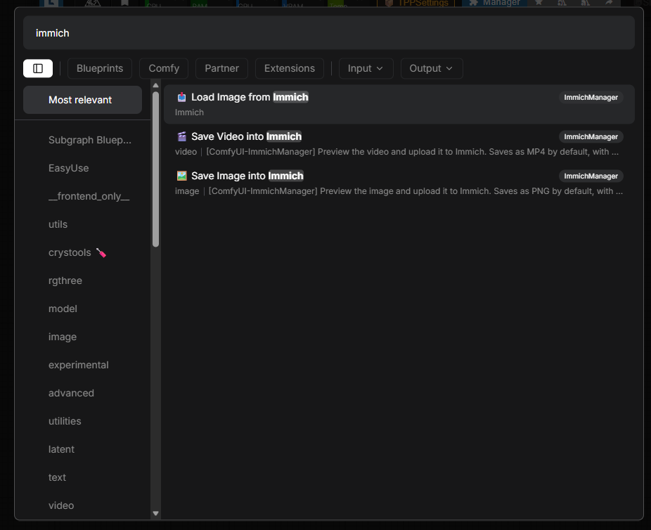
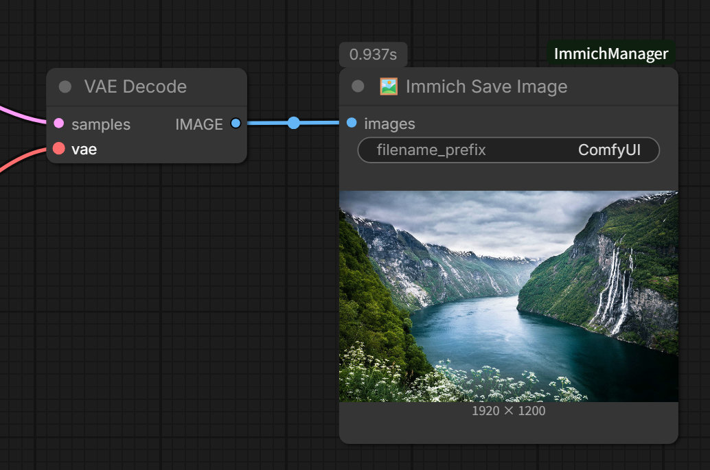
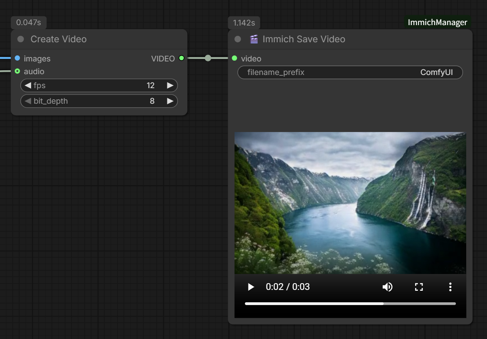

# ComfyUI-ImmichManager 🐾

**Upload ComfyUI-generated images/videos directly to your Immich library, with a built-in asset preview & management panel.**

[](./LICENSE)


> **English** | [简体中文](./README.zh-CN.md)

---

## Table of Contents

- [Features](#features)
- [Screenshots](#screenshots)
- [Installation](#installation)
- [Quick Start](#quick-start)
- [Usage](#usage)
- [Configuration](#configuration)
- [Security](#security)
- [FAQ](#faq)
- [Development](#development)
- [Contributing](#contributing)
- [License](#license)
- [Acknowledgements](#acknowledgements)

---

## Features

- **🖼️ `Immich Save Image` node** — uploads generated images (PNG) with the current workflow embedded; drag the file back from Immich to restore the workflow.
- **🎬 `Immich Save Video` node** — takes the official ComfyUI `VIDEO` type, encodes MP4 (H.264) with workflow metadata, and previews it in the node.
- **📥 `Load Image from Immich` node** — browse your whole Immich library from inside a workflow and turn a picked asset into `IMAGE` + `MASK`, or just its `asset_id`.
- **🗂️ Asset panel** — one panel with a toolbar button and a node button; thumbnail grid, detail pane, selection mode, filtering, sorting, grouping and pinning.
- **🔎 Filter builder** — combine album / person / tag / type / favourite / date-range conditions; the funnel icon lights up while any are active.
- **📐 Grouping** — month, day or year sections that fold, unfold and remember their state, plus an optional pinned section for today or the last seven days; no grouping renders one flat grid.
- **⬇️ Detail actions** — favourite, describe, **import the embedded workflow straight into the canvas**, open the asset in Immich, download the original, or send it to the Immich trash.
- **⚙️ Settings live in ComfyUI's own Settings dialog** under an `Immich` group, and the panel's gear button jumps there directly.
- **🌐 i18n** — English and Simplified Chinese. A fresh install starts in English; "follow system" is opt-in. Switching applies immediately, no reload.
- **🎨 Theme-aware** — follows ComfyUI's light and dark themes.

## Screenshots

**Entry point** — the flower button sits in ComfyUI's sidebar.



**The panel** — thumbnail grid on the left, detail pane on the right. The header is all icons: filter, sort, zoom, grouping, pinning, selection mode, then settings, open-in-Immich and close.



**Detail pane** — large preview, asset facts, description editing, and the actions: favourite, import the embedded workflow, open in Immich, download the original, delete.

**Filtering, grouping, pinning and selection** are described under [Usage](#usage) rather than shown: the toolbar carries a funnel that lights up while conditions are active, a grouping menu for month, day, year or none, a pin menu for today or the last seven days, and a copy-check button that enters selection mode.

**Sorting and zoom** — newest or oldest first, and three thumbnail sizes. The icon lights up while its menu is down.



**Settings** — the Immich group inside ComfyUI's own Settings dialog: connection, the panel token, the network proxy, the default album, page size, language and where the entry lives.



**Finding the nodes** — search "immich" in the Add Node menu to get all three: pick an asset out of the library, or save an image or a video into it.



## Installation

### 1. Option A: ComfyUI-Manager

Search for `ComfyUI-ImmichManager` in ComfyUI-Manager and install it, then restart ComfyUI.

### 2. Option B: Manual (git clone)

```bash
cd ComfyUI/custom_nodes
git clone https://github.com/oitsukiii/ComfyUI-ImmichManager.git ComfyUI-ImmichManager
```

Restart ComfyUI. The panel button appears in the top toolbar (🖼️ Immich).

### 3. Dependencies

| Package | Needed for | Note |
|---|---|---|
| `requests` | Immich REST client | Bundled with ComfyUI ≥ 0.30 |
| `pillow` | PNG encoding / metadata | Bundled with ComfyUI ≥ 0.30 |
| `aiohttp` | Panel backend (aiohttp routes) | Bundled with ComfyUI ≥ 0.30 |
| PyAV (`av`) | Video encoding via official `save_to` | Bundled with ComfyUI ≥ 0.30 |

**All dependencies ship with ComfyUI ≥ 0.30 — no extra install needed.** If your ComfyUI is older and the startup log shows `[ComfyUI-ImmichManager] dependencies missing ...`, run:

```bash
python -m pip install requests pillow aiohttp
```

and restart ComfyUI. The `[ComfyUI-ImmichManager]` log prefix always reports the dependency check result.

## Quick Start

1. Create an Immich API Key (Immich web → Administration → Settings → API Keys).
2. Restart ComfyUI, click **🖼️ Immich** in the toolbar → **⚙️ Configure**.
3. Fill in the Immich server URL (default `http://127.0.0.1:2283/api`; use `http://192.168.x.x:2283/api` for LAN) and the API key, then **Save**.
4. Click **Test Connection** to verify (shows the Immich version).
5. Open the panel from the sidebar's flower button to browse; add `🖼️ Immich Save Image` / `🎬 Immich Save Video` to your workflow to upload, or drag `📥 Load Image from Immich` in to pull assets back out.

## Usage

Both nodes take their connection settings (base URL / API key / default album) from the panel config — no connection inputs on the node itself.

### 1. 🖼️ Immich Save Image

| Input | Type | Description |
|---|---|---|
| `images` | IMAGE (required) | ComfyUI image tensor; each image is uploaded individually |
| `filename_prefix` | STRING | Filename prefix for uploads (default `ComfyUI`) |

- Fixed **PNG** output: the current `prompt` / `workflow` JSON is written into the PNG metadata — download the image from Immich and **drag it back into ComfyUI to restore the workflow** (tested end-to-end).
- The node has **no image output** (`OUTPUT_NODE`, a pure upload/save node) — keep other nodes' outputs if you need to continue processing.
- A copy is kept in the ComfyUI temp folder for the node preview (ComfyUI **clears the `temp/` folder on every startup**; files stay during runtime for the frontend preview).
- **Upload filenames carry a millisecond timestamp** (`ComfyUI_1755300000000_0.png`), so they never collide with existing library names.
- **Content-level dedup is done by the Immich server**: each upload carries `x-immich-checksum` (SHA-1); if an asset with identical content already exists, the server returns `duplicate` and **does not create a duplicate file**.
- **Retry**: 3× exponential backoff (1s/2s) on network errors / 5xx / 429 / 408 only.
- Global concurrency cap of 3 (semaphore); album lookup / create / batch-add with a lock against concurrent duplicate creation.
- Upload failure raises and interrupts execution — **images already uploaded to Immich are neither rolled back nor re-uploaded**; the error lists each failed file and its reason.

Example wiring:



### 2. 🎬 Immich Save Video

| Input | Type | Description |
|---|---|---|
| `video` | VIDEO (required) | Official ComfyUI VIDEO type — from `Create Video` / `Load Video` / `Video Slice`, … |
| `filename_prefix` | STRING | Filename prefix (default `ComfyUI`) |

- **No image-sequence input**: for old workflows, insert the official `Create Video` node between your frames and this node.
- Uses the official `VideoInput.save_to()` (PyAV) to write MP4 (H.264) with container metadata:
  - From `Create Video` → PyAV H.264 encode (preserves bit depth, 8/10-bit).
  - From `Load Video` (source mp4 + H.264) → **pure copy, no re-encode** (fast, lossless, keeps the source audio track & tags).
  - Other sources → auto-transcoded to MP4 (H.264).
- **Workflow metadata**: `prompt` / `workflow` JSON written into the MP4 container (official `use_metadata_tags` mechanism) — download from Immich and drag back to restore the workflow (tested with PyAV read-back).
- **Audio support**: audio tracks from `Create Video` are preserved.
- **In-node video preview**: same mechanism as the official `Save Video` node (`ui.images` + `animated`).
- **Streaming upload**: files are uploaded in chunks (SHA-1 + multipart streaming) — large videos are never fully read into memory.
- A local `.mp4` is kept in the ComfyUI temp folder for the preview (it is also the upload source; ComfyUI **clears the `temp/` folder on every startup**).

Example wiring:



### 3. 📥 Load Image from Immich

| Output | Type | Description |
|---|---|---|
| `image` | IMAGE | The picked asset, EXIF orientation applied |
| `mask` | MASK | Alpha channel when the asset has one, otherwise empty |
| `asset_id` | STRING | Immich asset id, so later nodes can refer to the original |

- The node's **Choose image** button opens the asset panel in pick mode: one click selects, the panel closes, and the thumbnail is drawn on the node itself.
- Grouping, filtering, sorting and zoom work exactly as in the main panel, but the pick panel keeps **its own state inside the node**, so it travels with the workflow JSON. The main panel keeps its state on the server.
- Reopening the picker restores the last selection, the scroll position and the preview pane.

### 4. Asset panel

Open it from the toolbar's 🖼️ button, or from the node's picker.

- **Header** — icons rather than text: filter (lit amber while conditions are active), sort, zoom, grouping, pinning, selection mode, plus settings, open-in-Immich and close.
- **Filtering** — build conditions from album, person, tag, type, favourite and date range. With no conditions the window says so and waits for **Add filter**.
- **Sorting** — newest or oldest first, applied inside every section.
- **Grouping** — month, day, year, or none. No grouping plus no pinning means one flat grid. Sections fold and remember it.
- **Pinning** — lifts today or the last seven days into a section at the top.
- **Selection mode** — shift-click for a range, batch favourite and move-to-trash, with a second confirmation when everything visible is selected.
- **Detail pane** — large preview (images and videos), favourite, description, workflow import, open in Immich, download, delete.
- **Thumbnails** — 64 / 112 / 200 px, lazy-loaded; the first page is 100 assets and **Load more** appends the rest instead of blocking on a long fetch.
- **State** — filters, sorting, grouping and pinning survive a reload.

## Configuration

Everything is configured in **ComfyUI's own Settings dialog**, under the `Immich` group — the panel's gear button takes you straight there. The values are stored in `<plugin>/config.json`, **auto-generated on first save**, **git-ignored** and written `0o600`, so your API key is never committed. The main panel's own state lives beside it in `panel_state.json`, which is git-ignored too.

The old standalone config page is gone; its reset button went with it. Settings live in the dialog, and the panel remembers its own filters, sorting, grouping and pinning on the server.

| Field | Description |
|---|---|
| `base_url` | Immich API URL. **http/https only** (SSRF checks: rejects IP-obfuscation / link-local / reserved ranges / redirects — see Security). |
| `api_key` | Immich API key. **Stored only in the backend config.json; never sent to the browser** — the frontend only sees `api_key_configured: true/false`. |
| `panel_token` | Panel access token. When set, every `/api/immich_plus/*` request must send `Authorization: Bearer <token>`. **Auto-generated when you save the connection config**; the 🔒 Security group in the Settings dialog lets you **check / copy / regenerate / clear** it. |
| `default_album` | Default album for upload nodes (nodes have no album input; configured here). |
| `page_size` | Pagination size (min 1, max 1000). |
| `proxy_mode` | Network proxy mode: `off` (default) / `custom` / `env`. See below. |
| `proxy_url` | Proxy address for `proxy_mode=custom`, e.g. `http://127.0.0.1:7897` (Clash / mihomo Mixed Port). **http/https only; username/password not supported.** Outside `custom` mode it is kept as a standby value; **saving an empty field clears it.** |

### 🌐 Network proxy (`proxy_mode` / `proxy_url`)

The **🌐 Network proxy** group in the Settings dialog controls **how this plugin reaches Immich over the network**:

| Mode | Meaning | When to use |
| --- | --- | --- |
| `off` **No proxy (default)** | Ignores `HTTP_PROXY` / `HTTPS_PROXY` / `ALL_PROXY` in the process environment; LAN connections stay **direct** | Almost always, especially when Immich runs on a NAS / LAN |
| `custom` Custom proxy | All Immich requests explicitly go through the proxy address you fill in (environment variables are still ignored, so nothing can hijack it twice) | Immich is remote and must be reached through a proxy |
| `env` Follow environment variables | Keeps using the proxy env vars of the ComfyUI process (**legacy behaviour**) | You always relied on `HTTP_PROXY` to reach Immich |

> 💡 **Why is "No proxy" the default?**
> Many ComfyUI launch scripts set `HTTP_PROXY=http://127.0.0.1:7897` (Clash's default port) for ComfyUI-Manager. Python's `requests` **honours those variables unconditionally**, so even requests to a **LAN** Immich were pushed through the proxy — and if Clash is not running, uploads fail with
> `ProxyError ... [WinError 10061] No connection could be made because the target machine actively refused it`.
> With `off`, Immich is reached directly, **so a stopped proxy client can never break the LAN path**, while ComfyUI-Manager and other plugins still use the env vars.
>
> Upgrading from an older version: if you could only reach Immich **through** a proxy, switch to "Follow environment variables" or "Custom proxy" and fill in the address.

Proxy address validation follows the same discipline as `base_url`: http/https only, host required, **no username/password** (credentials are never written to `config.json`), no path/query, and link-local / reserved addresses plus IP-obfuscation literals are rejected.

When a proxy variable is detected in the process environment, the settings group shows a hint (`proxy_env`, **always credential-masked**) so you can tell why an env var seems to have no effect.

## Security

The threat model — trust boundaries, a per-route table of who can call what with which secret, and the accepted risks — is in [THREAT_MODEL.md](THREAT_MODEL.md).


This section starts from the **panel access token** you actually see in the 🔒 Security group of the Settings dialog, and explains it step by step.

### 1. What is the panel access token?

Open ComfyUI's Settings dialog, pick the `Immich` group, and find 🔒 **Security** with the **panel access token**:

- It is **auto-generated when you save the connection config**; normally you don't have to think about it;
- The Security group has **Show / Regenerate / Clear** buttons so you can view or rotate it anytime.

It is the **key to the panel**: once set, other devices on your LAN must enter this key before they can open the panel; otherwise requests are rejected (401).

### 2. Why is it needed?

ComfyUI itself has no server-level access key (verified on 0.30.0) — anyone who can reach your ComfyUI page can operate the panel. Your Immich API key is hidden in the backend `config.json`, but **if the panel itself is open, anyone who can reach your machine or LAN can control your Immich**.

So this plugin ships minimal built-in auth: once the panel access token is set, every panel request must carry it, or it gets a 401.

> ⚠️ **No token = trust mode**: in that state, anyone who can reach your ComfyUI port can read/write your Immich library. For local-only use, run ComfyUI with `--listen 127.0.0.1`; if you need LAN access, make sure a token is set.

### 3. Your machine (the one running ComfyUI) never enters the token

The panel is **always trusted on localhost / 127.0.0.1** — even if you regenerate or clear the token, the machine running ComfyUI can always get back in, so you can never lock yourself out. Other devices still need the token.

> The check uses the real network source of the connection and **does not trust the spoofable `X-Forwarded-For` header**.

### 4. How do other (LAN) devices access the panel?

A LAN device opens the panel → is asked for the token → after entering it:

- **Default**: the token is kept only in the **current browser tab** (sessionStorage) and is cleared when the tab or browser closes — enter it again next time;
- **Optional**: check **"☑ Remember token on this device"** to store it in the browser's localStorage, which survives browser restarts — no re-entry next time.

> ⚠️ Before checking "Remember", read the UI warning: **any same-origin script (including other custom nodes' JS) can read localStorage**. Only check it in a browser you trust.

### 5. Where is the token stored?

- **Backend**: the plaintext lives only in the plugin's `config.json` (file permission `0o600`, owner read/write only) and is **never sent back to the browser** — the frontend only sees "configured / not configured", never the token itself;
- **Browser**: only a **copy** of what you entered (or revealed in the Security group) is kept — sessionStorage by default, localStorage when "Remember" is checked (step 4).

### 6. Important: this is a "full-access key"

Whoever holds the token can: view/delete your Immich assets, change the plugin config, and even regenerate or clear the token itself.

- It is designed for **one person across their own devices — do not share it**;
- Any same-origin script that can run JS can read the token in the browser — keep the ComfyUI page free of XSS (don't install unknown custom nodes).

### 7. Technical details (read when troubleshooting)

- **Connection URL validation**: `base_url` accepts http/https only; rejects userinfo, IP-obfuscated literals, link-local/reserved addresses, and never follows redirects (anti-SSRF). Private ranges (e.g. 192.168.x.x) are allowed **by design** for LAN usage — **whoever can configure the URL is trusted**, so set a token and bind ComfyUI to a trusted network.
- **Image/video loading**: fetch + blob (Authorization header); the token **never appears in URL query parameters or access logs**.
- **Delete safety**: deletes always go to the Immich trash and can be restored from the Immich web UI.
- **Logging**: never enable DEBUG logging for `requests` while debugging (it logs request headers including the API key). Use INFO or read the `[ComfyUI-ImmichManager]` prefixed lines.

## FAQ

**Q: The panel is slow / takes long on first open?**
A: The panel asks for one page of a hundred assets and draws it straight away; **Load more** at the bottom fetches the next page, so the first paint no longer waits on a long walk through the library. Thumbnails are lazy-loaded as you scroll.

**Q: Video preview stutters / very large videos won't play?**
A: The panel downloads the video into browser memory (fetch + blob) before playing — the security cost of keeping the token out of URLs. For very large videos, use the 🌐 **Open Immich** button and play in the Immich web UI.

**Q: Can uploaded images/videos be dragged back to restore the workflow?**
A: Yes. Images (PNG) and videos (MP4) carry the current `prompt` / `workflow` metadata; download from Immich and drag into the ComfyUI canvas (tested).

**Q: Can deleted assets be recovered?**
A: Deletes always go to the Immich trash (tested on v2.x); restore from the Immich web UI. The plugin does not offer "empty trash".

**Q: Upload fails with `ProxyError ... [WinError 10061] No connection could be made...` or cannot reach a LAN Immich?**
A: Your ComfyUI process environment carries proxy variables (typically `HTTP_PROXY=http://127.0.0.1:7897`, set by your launch script for ComfyUI-Manager) while that proxy client is not running — so requests to a **LAN** Immich get pushed through it too. Set **🌐 Network proxy → No proxy** in the Settings dialog (the default; takes effect right after saving) to go direct. If you really reach Immich through a proxy, pick "Custom proxy" and fill in the address, or "Follow environment variables". The settings group shows the detected env var as a hint.

## Development

```bash
# Unit / route tests (test_client.py needs a real Immich + a test key)
python3 tests/test_config.py
python3 tests/test_routes.py
python3 tests/test_upload_node.py
python3 tests/test_extract.py
python3 tests/test_client_bulk_offline.py
IMMICH_TEST_KEY=xxx python3 tests/test_client.py
```

Architecture & API contract: `docs/PLAN.md` (historical design document — this README is authoritative).

## Contributing

Issues and pull requests are welcome. For feature requests or bug reports, please open a GitHub issue with:
- ComfyUI version & platform
- Immich version
- Steps to reproduce + the `[ComfyUI-ImmichManager]` log lines

Please follow the existing code style (Chinese comments in code, module docstrings) and run the offline tests before submitting.

## License

[MIT](./LICENSE) © 2026 ComfyUI-ImmichManager Contributors

## Acknowledgements

- Developed with a **vibe coding** workflow — built with the assistance of **DeepSeek V4 Flash** and **DeepSeek V4 Pro** for design, implementation and code review.
- Thanks to [ComfyUI](https://github.com/comfyanonymous/ComfyUI) for its rich node ecosystem and stable extension mechanism, which make custom node development a pleasure.
- Thanks to [Immich](https://github.com/immich-app/immich) for its comprehensive REST API — the album, timeline, trash and other capabilities of this plugin are built on its excellent design.
